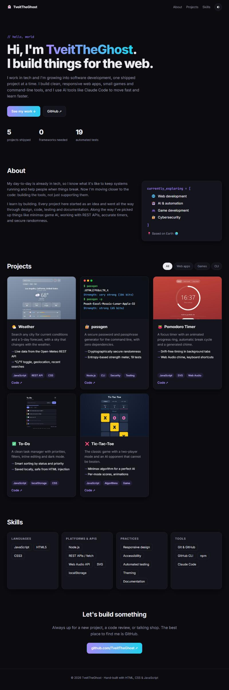

# 👻 TveitTheGhost · Portfolio

My personal portfolio site: who I am, what I'm exploring, and the projects I've built. It's hand-built with plain HTML, CSS and JavaScript, with no frameworks and no build step.

### 🌐 [Visit it live → tveittheghost.github.io](https://tveittheghost.github.io/)



## ✨ Features

- **Data-driven project cards:** every card is generated from `projects.json`, which also feeds the auto-updating project table on my GitHub profile
- **Project filters** for Security, Web apps, Games and CLI
- **Live stats:** the project and test counts in the hero are calculated from the data
- **Light and dark mode** that follows your system and remembers your choice
- **Terminal-style previews** for command-line projects, built in CSS
- **Sticky blurred nav**, smooth scrolling, a floating ghost 👻, and fade-in cards
- **Respects "reduce motion"** settings for people who prefer less animation
- **Responsive:** single-column layout on phones with no sideways scrolling

## ➕ Adding a project

Add an entry to `projects.json` (newest first):

```json
{
  "name": "My New Project",
  "emoji": "🚀",
  "categories": ["app"],
  "image": "images/my-project.jpg",
  "description": "One or two sentences about it.",
  "highlights": ["Something impressive", "Something else"],
  "tags": ["JavaScript", "CSS"],
  "builtWith": "JavaScript · CSS",
  "tests": 12,
  "repo": "https://github.com/TveitTheGhost/my-new-project",
  "live": null,
  "private": true
}
```

- `categories`: any of `security`, `app`, `game`, `cli` (drives the filters)
- `terminal`: use instead of `image` for CLIs, as a list of `["style", "text"]` lines (`prompt`, `pw`, `ok`, `warn`, `bad`, `dim`)
- `tests`: optional; added up for the "automated tests" stat
- `builtWith`: shown in the profile README table
- `live`: a URL adds a "Live demo" link; `private: true` shows "🔒 Private repo" instead of a code link

The site and the profile README both update from this one file.

## 🛠️ Built with


---

Made by [TveitTheGhost](https://github.com/TveitTheGhost) · MIT License
